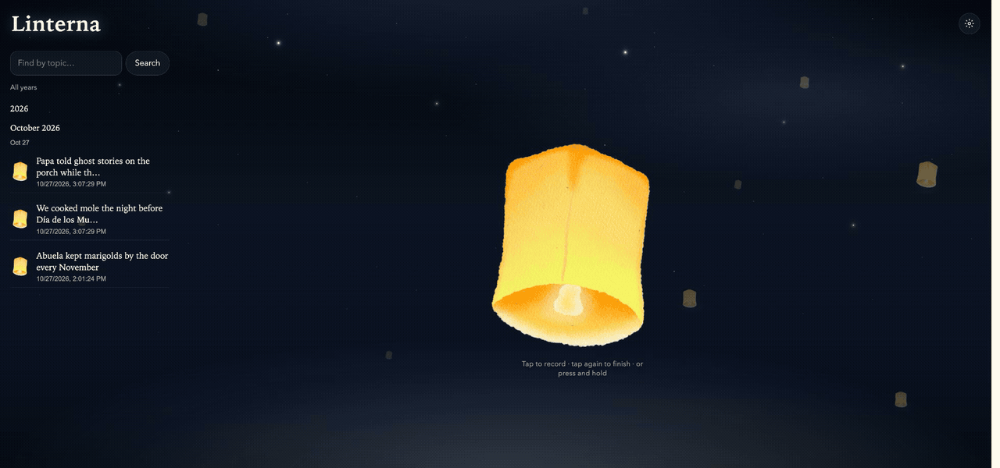

# Linterna

Keep a voice, not just a transcript. Linterna is a local oral-history lantern:
record a memory, keep the original audio, find its words later and hear it again.
No accounts. Memories and recordings stay together in the local SQLite database.



The demo uses synthetic speech, with real private speech inference and local storage.

## Requirements

- Python 3.11 or newer and `make`.
- A current Chrome, Edge or Safari browser with microphone access.
- FFmpeg is optional, recommended for seekable browser recordings. On macOS,
  `brew install ffmpeg`; on Debian/Ubuntu, `sudo apt install ffmpeg`.
- Node.js 22+ is needed only for the recorder tests, not to run the app.
- A compatible speech endpoint is optional. Recording, local saving, manual
  transcripts and original-voice playback work without one.

## Run

```sh
git clone https://github.com/EdyVision/linterna.git
cd linterna
make install
make start
```

Open http://127.0.0.1:8787. Allow the microphone when you choose to record.
Keep that terminal running; Ctrl+C stops the server. Use `make health` to check it.
The first start creates `data/linterna.db` and `data/config.json` automatically.
Use localhost or HTTPS; browsers restrict microphone access on insecure remote sites.

## Keep a memory

1. Tap the lantern to start, then tap again to finish. Press-and-hold also works;
   Space or Enter operates the same control from a keyboard.
2. Preview your actual voice. A configured ASR service creates an editable transcript.
   If transcription fails, the audio remains available and can still be saved.
3. Save the memory. Browse by year/month/day or search the words of its transcript.
4. Play recording to hear the original voice. Read transcript is a separate option
   using configured narration or browser speech for older text-only memories.

Recordings are limited to five minutes and 25 MB. Deleting a memory also deletes
its stored recording. Existing text-only memories are preserved during migration.
Transcripts should be checked for names, accents and mistakes before saving.

## Speech services

Config accepts an OpenAI-compatible ASR base URL and model, plus optional narration
base URL, model and voice. ASR accepts an origin, `/v1` base or full
`/v1/audio/transcriptions` URL. Browser recordings are converted to mono 16 kHz PCM
WAV for transcription; the original browser recording is retained for playback.
An installed FFmpeg is used to finalize WebM/MP4/Ogg containers with seekable
duration metadata, copying encoded audio without changing the voice. WAV recordings
need no conversion. Without FFmpeg the original container is kept, though some
browsers may not display its duration until playback ends.

No model is downloaded, service started or paid account created by Linterna.

For a private authenticated bridge, set these on the server or in an ignored,
owner-readable `.env.local` (never in browser code or public configuration):

```sh
LINTERNA_SPEECH_ORIGIN=https://your-private-speech-service.example
LINTERNA_SPEECH_API_KEY=your-existing-service-key
```

Credentials are sent only to that exact origin. Changing a model URL cannot forward
this key to another host. Responses and browser-visible configuration contain no key.
Keep the default loopback binding; this is a personal local app, not a public server.

Without an ASR endpoint, supported browsers can provide browser speech captions,
which may use the browser vendor's online service. Typing and audio-only saving
remain available. Configured transcription/narration services process the audio/text
sent to them and control their own retention. This is not voice cloning or a simulated
conversation with a remembered person.

## Visuals

The original watercolor lantern art is retained. Each background lantern rises and
sways independently; occasional straight meteor trails cross the sky. Reduced-motion
settings disable movement, and hidden pages pause decorative animations.

## Tests

```sh
.venv/bin/python -m unittest discover -s tests -v
node --test tests/recorder.test.mjs
```

Tests use temporary databases and synthetic audio. They cover original audio storage,
range playback, migration, search, deletion, ASR failures, credential-origin binding,
recorder cleanup and late permission/data callbacks. Live provider validation is
separate from these deterministic tests.
